# One Tag Protects Everything: Building a Cross Region AWS Backup Plan

*Cloud Project : Centralized Backup and Disaster Recovery Solution on AWS | Day 2 of 5*

Most backup setups fail quietly. Someone launches a new database, forgets to add it to the backup job, and nobody notices until the day they need a restore. On Day 2 of this project I built a backup plan that removes that risk: protection is decided by a tag, not by a person remembering.

Everything here was built by hand in the AWS Console.

## What I built today

- Four sample workloads: an EC2 web server, an RDS MySQL database, an EFS file system and a DynamoDB table
- Two customer managed KMS keys and two backup vaults, one pair per Region
- One backup plan with a daily rule and a weekly rule
- Automatic copies of every backup from N. Virginia (us-east-1) to Oregon (us-west-2)


*📎 Attach: `backup plan.png`: Backup plan with daily and weekly rules, both copying to bkp-dr-vault*

## Step 1: Prepare the account

Before touching any workload I set a $10 monthly budget with an alert at 80 percent, so a forgotten resource cannot surprise me.

Then, in AWS Backup settings, I opted in every service I planned to protect (EC2, EBS, RDS, EFS, DynamoDB) in both Regions.

The step most people miss: **turn on advanced features for DynamoDB backups.** Without it, DynamoDB backups cannot be copied to another Region or moved to cold storage. I found this before it bit me, and it is the easiest win in the whole project.

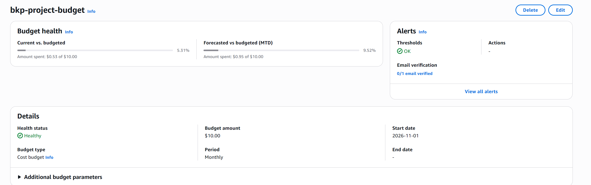
*📎 Attach: `budget-aws.png`: $10 monthly budget with 80% alert*

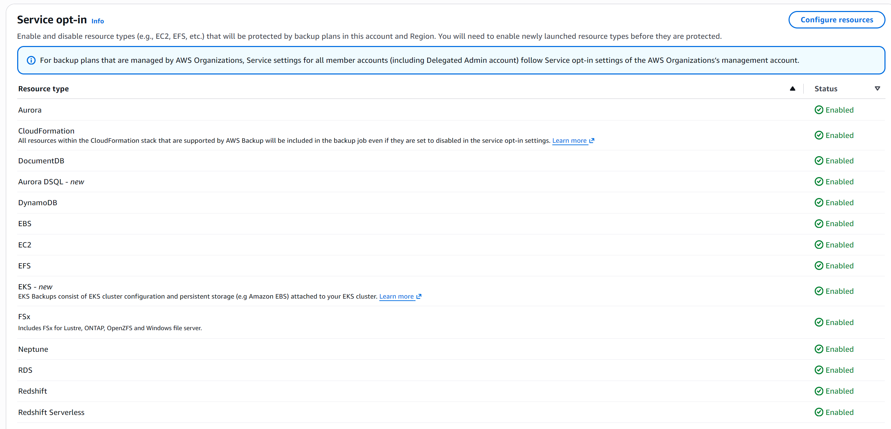
*📎 Attach: `aws-backup.png`: Service opt-in enabled for all resource types*

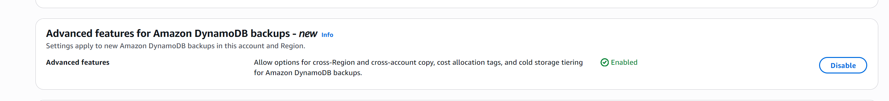
*📎 Attach: `dynamo-db-advance.png`: DynamoDB advanced features enabled*

## Step 2: Tag the workloads

I created four small resources and gave each one the same tag:

```
backup = daily-weekly
```

| Resource | Name | Notes |
| --- | --- | --- |
| EC2 | bkp-web-01 | t3.micro, writes a marker file with the date at boot |
| RDS | bkp-db-01 | MySQL free tier, 20 GB |
| EFS | bkp-efs-01 | Built in automatic backups turned off so my plan owns it |
| DynamoDB | bkp-orders | 3 sample orders to check after a restore |

The EC2 marker file and the DynamoDB items matter later. On restore day I can prove which point in time came back.

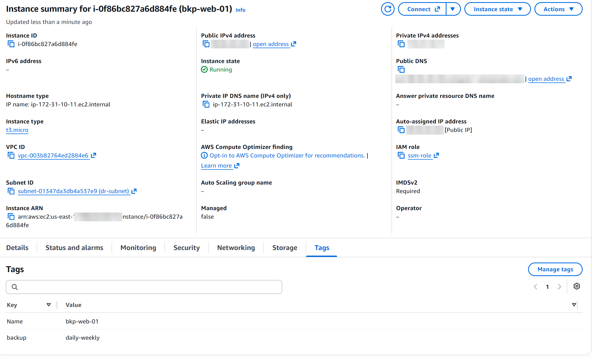
*📎 Attach: `ec2-details.png`: EC2 bkp-web-01 with the backup tag*

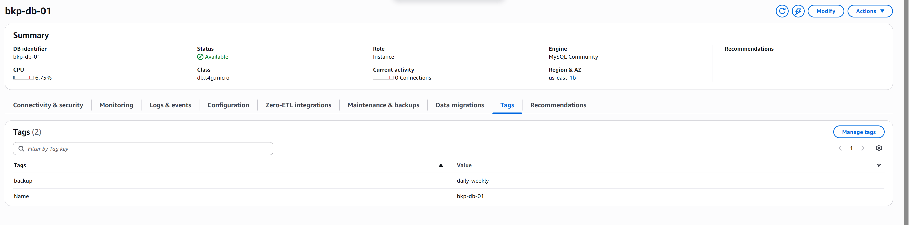
*📎 Attach: `rds-tag.png`: RDS bkp-db-01 with the backup tag*

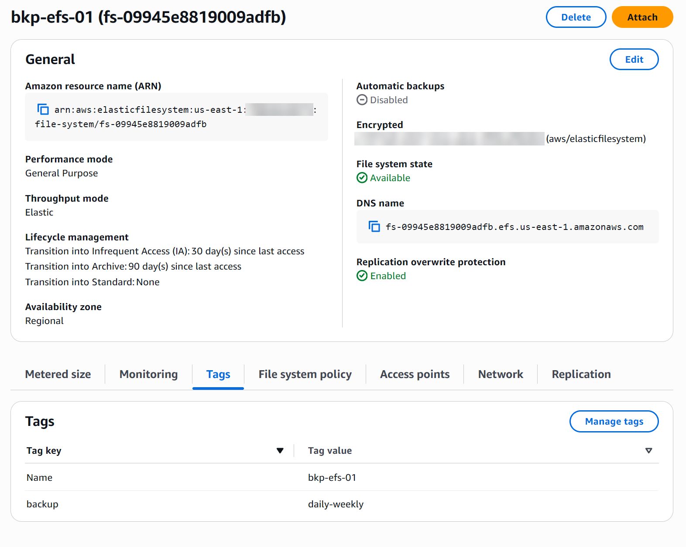
*📎 Attach: `efs-details.png`: EFS bkp-efs-01, automatic backups disabled, backup tag*

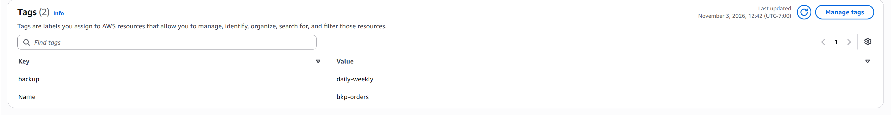
*📎 Attach: `dynamodb-tag.png`: DynamoDB bkp-orders with the backup tag*

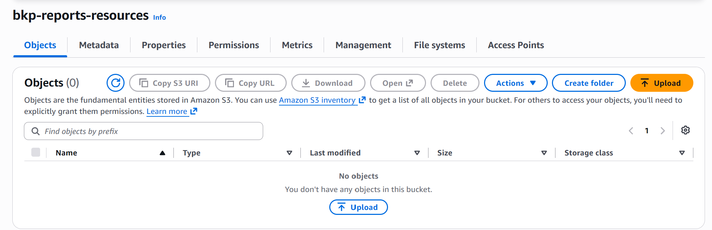
*📎 Attach: `s3-bucket-reports.png`: S3 bucket for reports*

## Step 3: Two keys, two vaults

This was the surprise of the day. **KMS keys belong to a single Region.** A backup copied to Oregon has to be encrypted again with a key that lives in Oregon.

So the design has two halves:

| Region | KMS key | Backup vault |
| --- | --- | --- |
| N. Virginia (primary) | bkp-vault-key | bkp-primary-vault |
| Oregon (DR) | bkp-vault-key-dr | bkp-dr-vault |

Why not the Default vault? It uses an AWS managed key that I cannot restrict. With my own vault and key, I control who can use the key, and on Day 3 I can lock the vault and block deletion.

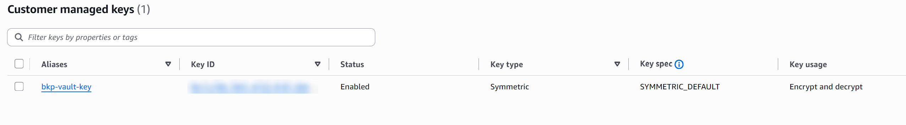
*📎 Attach: `customer-mng-key.png`: Customer managed KMS key bkp-vault-key*

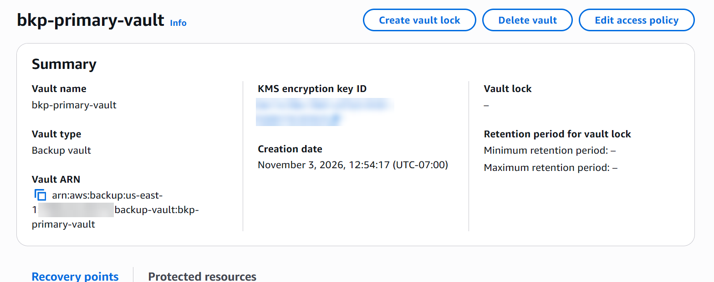
*📎 Attach: `bkp-primary-vault.png`: Primary vault in N. Virginia with its own KMS key*

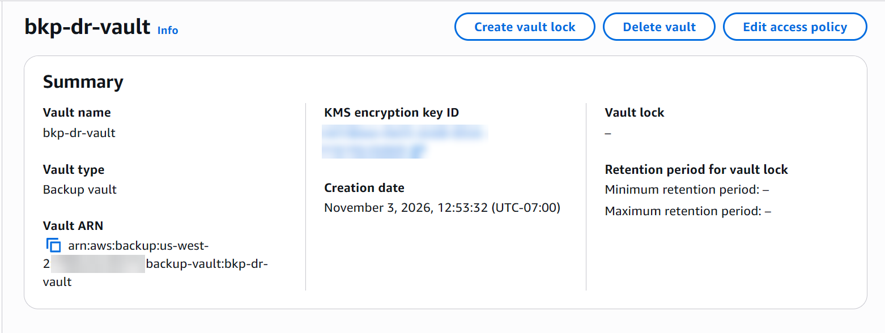
*📎 Attach: `bkp-dr-vault.png`: DR vault in Oregon with its own KMS key*

## Step 4: The backup plan

The plan `bkp-plan-daily-weekly` has two rules:

| Rule | Schedule | Lifecycle | Copy to Oregon |
| --- | --- | --- | --- |
| daily | Every day, 14:30 | Keep 7 days | Yes, keep 7 days |
| weekly | Sundays, 14:30 | Cold storage after 30 days, keep 120 days | Yes, same lifecycle |

Why 120 days? Cold storage needs at least 90 days after the move, so 30 plus 90 is the shortest valid setting. RDS ignores cold storage; EFS and DynamoDB actually move to the cheaper tier.

Then the part that makes it maintenance free. Instead of choosing resources one by one, the resource assignment says: **include EC2, RDS, EFS and DynamoDB where the tag backup equals daily-weekly.** Anything launched later with that tag is protected from its first day.

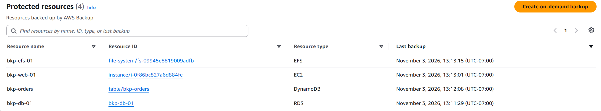
*📎 Attach: `resources-plan.png`: Protected resources picked up by the tag rule*

After the assignment created the AWS Backup service role, I added that role as a key user on both KMS keys so it can encrypt in both Regions.

## Step 5: Test it today, not tomorrow

I did not wait for the first scheduled run. I ran an on demand backup for all four resources. All four completed.

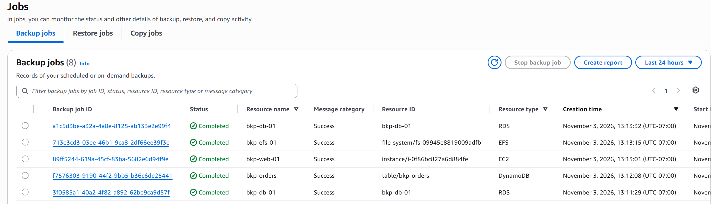
*📎 Attach: `backup-jobs.png`: On demand backup jobs completed for all 4 resources*

Then I copied each recovery point to the Oregon vault. All four copy jobs completed: EC2, RDS, EFS and DynamoDB.

The EC2 copy moved **8 GiB from N. Virginia to Oregon in about 2.5 minutes** (13:42:59 to 13:45:24).

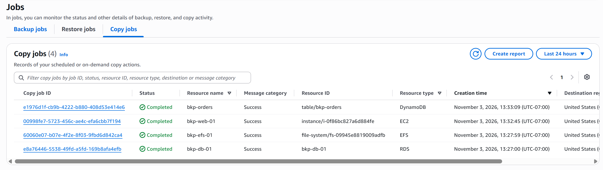
*📎 Attach: `copy-job.png`: 4 cross Region copy jobs completed*
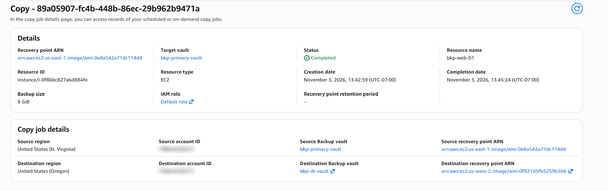
*📎 Attach: `copy-job-detail.png`: EC2 copy: 8 GiB from N. Virginia to Oregon in about 2.5 minutes*

Finally I opened the Oregon vault and confirmed the recovery points were sitting there, encrypted with the Oregon key.

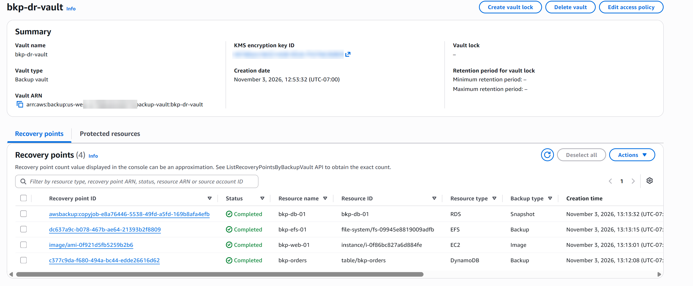
*📎 Attach: `bck-dr.png`: 4 recovery points in bkp-dr-vault, Oregon*

I also saved the plan as JSON from CloudShell so it lives in the GitHub repo:

```bash
aws backup get-backup-plan --backup-plan-id <plan-id>
```

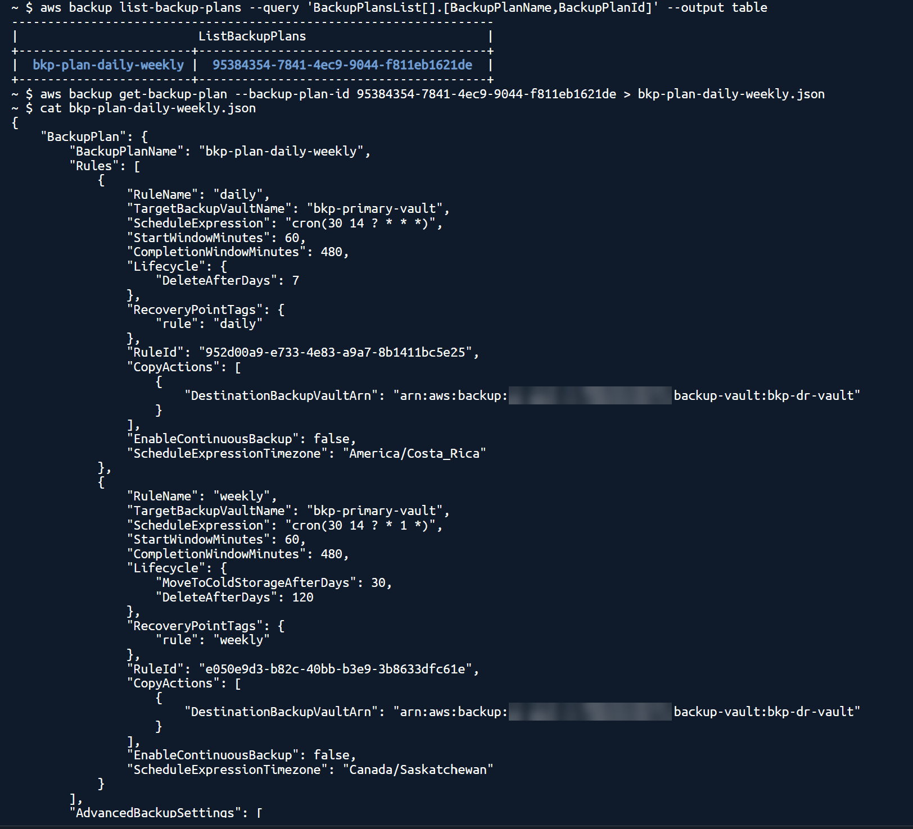
*📎 Attach: `bacup-plan-cli.png`: Backup plan JSON from CloudShell*

## What I learned

1. **Tags beat lists.** A list of resources goes stale. A tag rule does not.
2. **KMS keys are Regional.** Cross Region backup means a key and a vault in each Region.
3. **Enable DynamoDB advanced features first.** It is one click, and skipping it breaks cross Region copy.
4. **Test on demand.** A plan that has never run is a plan you are only hoping works.

## Next: Day 3

Right now, anyone with admin access could delete these backups. That is exactly what ransomware does first. Tomorrow I lock the vaults, add a deny policy for deletes, and prove it by getting an AccessDenied on my own admin account.

*Follow #CloudProject4 for the rest of the series.*
